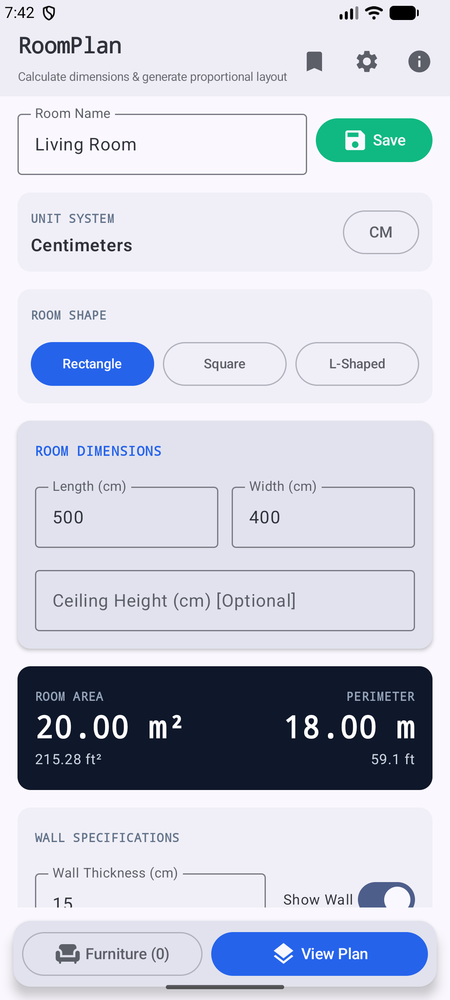

# RoomPlan 📐🏡

[](https://kotlinlang.org)
[](https://developer.android.com)
[](https://developer.android.com/jetpack/compose)
[](LICENSE)

**RoomPlan** is a modern, feature-rich Android floor planning and interior design application built with **100% Kotlin**, **Jetpack Compose**, and **Material 3**. It allows users to design 2D room layouts, place and customize doors, windows, columns, and furniture items, compute real-time room dimensions and utilization metrics, automatically arrange furniture using an intelligent layout engine, and export high-resolution PDF or PNG floor plans.

---

## 📸 Screenshots

| Floor Plan Canvas & Auto Layout |
| :---: |
|  |

---

## ✨ Key Features

### 📐 1. Interactive 2D Floor Plan Canvas
- **Dynamic 2D Rendering**: Render room boundaries, doors, windows, structural columns, and furniture in real time using custom Compose `Canvas` drawing.
- **Pinch-to-Zoom & Pan**: Smooth multi-touch gestures for zooming and panning across large floor plans.
- **Grid & Snapping**: Optional grid overlay with configurable snap-to-grid spacing for accurate object alignment.
- **Real-time Dimension Lines**: Clear dimension annotations along wall edges and furniture boundaries.

### 🏠 2. Flexible Room Customization
- **Multiple Room Shapes**: Support for **Rectangular**, **Square**, and **L-Shaped** room configurations.
- **Custom Dimensions**: Set room length, width, ceiling height, cutout sizes (for L-shapes), and wall thickness.
- **Dimension Modes**: Switch between **Inside** (internal clear dimensions) and **Outside** (external wall boundary) measurements.
- **Architectural Openings**: Add and configure doors (hinged/sliding, swing direction) and windows (with sill and opening heights).
- **Structural Columns**: Place interior support columns with precise dimensions and coordinates.

### 🛋️ 3. Furniture Library & Custom Items
- **Comprehensive Pre-built Catalog**: Includes pre-configured furniture for Bedroom (Beds), Living Room (Sofas, Center Tables, TV Units), Dining (Tables & Chairs), Storage (Wardrobes, Dressers, Bookshelves), Office (Desks, Office Chairs), Kitchen, and Utility.
- **Custom Furniture**: Add custom furniture items with tailored width, depth, height, and display names.
- **Interactive Editing**: Drag-and-drop positioning, 90-degree increment rotation, resizing, duplicating, and deletion.

### 🤖 4. Intelligent Auto-Layout Engine (`AutoLayoutEngine`)
- **Algorithmic Placement**: Automatically places and arranges furniture in optimal positions while respecting:
  - Wall preferences (e.g., beds, sofas, wardrobes prefer wall alignment).
  - Door clearance zones to ensure unobstructed doorways.
  - Column locations and existing furniture collision boundaries.
  - Walking paths and optimal spatial balance.

### 📊 5. Real-Time Room Analytics & Calculations (`RoomCalculator`)
- **Floor & Wall Area**: Calculates total floor area ($m^2$ or $ft^2$), perimeter length, and net wall area (accounting for door and window cutouts).
- **Furniture Footprint**: Tracks cumulative furniture surface area and computes total room space utilization percentage.
- **Opening Summaries**: Computes total linear length and aggregate surface area of doors and windows.

### 📄 6. High-Resolution PDF & Image Export (`ExportManager`)
- **PDF Export**: Generates professional PDF document sheets featuring a scaled floor plan diagram, room specifications, dimension breakdowns, and furniture inventory.
- **PNG Image Export**: Render crisp, high-resolution floor plan images for sharing via external apps or saving to device storage.

### 📏 7. Multi-Unit Measurement System
- **Metric System**: Millimeters ($mm$), Centimeters ($cm$), Meters ($m$).
- **Imperial System**: Feet ($ft$), Inches ($in$).
- **Seamless Conversion**: Automatically converts all room dimensions and furniture sizes when changing units.

### 💾 8. Local Storage & Plan Management (`PlanStorage`)
- **Save & Load**: Store up to 20 local room plans powered by lightweight JSON serialization.
- **Plan Operations**: Create, duplicate, rename, update notes, load, and delete saved room plans.
- **Auto-Restore**: Option to automatically reload the last active plan on app launch.

---

## 🛠️ Tech Stack & Architecture

- **Language**: Kotlin 2.0
- **UI Architecture**: Jetpack Compose + Material 3 Design System
- **State Management**: MVVM Architecture with Kotlin `StateFlow` and Coroutines
- **Navigation**: Jetpack Compose Navigation (`androidx.navigation.compose`)
- **Graphics Engine**: Android `Canvas`, `Paint`, and `Path` API
- **PDF Generation**: Android `PdfDocument` engine
- **Local Persistence**: `SharedPreferences` with structured JSON serialization
- **Target SDK**: Android 15 / SDK 37 (Min SDK 26)

---

## 📁 Project Structure

```
RoomPlan/
├── app/
│   ├── src/
│   │   ├── main/
│   │   │   ├── java/com/example/roomplan/
│   │   │   │   ├── MainActivity.kt               # Entry Point & Jetpack Compose Navigation
│   │   │   │   ├── data/
│   │   │   │   │   ├── ExportManager.kt          # PDF and Bitmap Rendering & Export Engine
│   │   │   │   │   ├── PlanStorage.kt            # JSON Serializer & Local Storage
│   │   │   │   │   └── SettingsStorage.kt        # User Preferences Persistence
│   │   │   │   ├── engine/
│   │   │   │   │   ├── AutoLayoutEngine.kt       # Automatic Furniture Arrangement Algorithm
│   │   │   │   │   ├── RoomCalculator.kt         # Area, Perimeter, & Utilization Calculations
│   │   │   │   │   ├── RoomCollisionEngine.kt    # Object Collision & Bounds Checking
│   │   │   │   │   └── RoomPlanGenerator.kt      # Canvas Viewport Scaling & Grid Snapping
│   │   │   │   ├── model/
│   │   │   │   │   ├── Enums.kt                  # Room Shapes, Wall Sides, Door Swings, etc.
│   │   │   │   │   ├── FurnitureType.kt          # Predefined Furniture Catalog
│   │   │   │   │   ├── PlanModels.kt             # Core Data Classes (RoomPlan, Door, Window, etc.)
│   │   │   │   │   ├── SettingsModels.kt         # App Settings & Unit Types
│   │   │   │   │   └── UnitType.kt               # Measurement Units & Conversions
│   │   │   │   ├── ui/
│   │   │   │   │   ├── navigation/               # Screen Route Definitions
│   │   │   │   │   ├── screens/                  # Compose Screen Views (Home, Plan, Furniture, Saved, Settings)
│   │   │   │   │   ├── theme/                    # Material 3 Color Palette, Typography & Theme
│   │   │   │   │   └── viewmodel/                # RoomPlanViewModel & RoomPlanUiState
│   │   │   ├── AndroidManifest.xml
│   │   │   └── res/
│   │   └── test/
│   │       └── java/com/example/roomplan/
│   │           └── RoomPlanUnitTest.kt           # Unit Tests for Engine, Storage & Calculations
│   └── build.gradle.kts
├── build.gradle.kts
├── gradle.properties
├── settings.gradle.kts
└── README.md
```

---

## 🚀 Getting Started

### Prerequisites

- **Android Studio**: Ladybug (2024.2.1) or newer recommended.
- **JDK**: Java 11 or higher.
- **Android Device / Emulator**: Running Android 8.0 (API Level 26) or higher.

### Installation & Build

1. **Clone the repository**:
   ```bash
   git clone https://github.com/abdullah-ateeq/RoomPlan.git
   cd RoomPlan
   ```

2. **Open in Android Studio**:
   - Open Android Studio, select **Open**, and navigate to the cloned `RoomPlan` project directory.

3. **Build & Run**:
   - Select your target device or emulator.
   - Click **Run** (`Shift + F10`) or execute from command line:
     ```bash
     ./gradlew assembleDebug
     ```

---

## 🧪 Testing

The project includes unit tests covering room calculations, JSON plan serialization, collision detection, unit conversions, and the auto-layout engine.

Run unit tests via Gradle:
```bash
./gradlew test
```

---

## 📄 License

```text
MIT License

Copyright (c) 2025 Abdullah Ateeq

Permission is hereby granted, free of charge, to any person obtaining a copy
of this software and associated documentation files (the "Software"), to deal
in the Software without restriction, including without limitation the rights
to use, copy, modify, merge, publish, distribute, sublicense, and/or sell
copies of the Software, and to permit persons to whom the Software is
furnished to do so, subject to the following conditions:

The above copyright notice and this permission notice shall be included in all
copies or substantial portions of the Software.

THE SOFTWARE IS PROVIDED "AS IS", WITHOUT WARRANTY OF ANY KIND, EXPRESS OR
IMPLIED, INCLUDING BUT NOT LIMITED TO WARRANTIES OF MERCHANTABILITY,
FITNESS FOR A PARTICULAR PURPOSE AND NONINFRINGEMENT. IN NO EVENT SHALL THE
AUTHORS OR COPYRIGHT HOLDERS BE LIABLE FOR ANY CLAIM, DAMAGES OR OTHER
LIABILITY, WHETHER IN AN ACTION OF CONTRACT, TORT OR OTHERWISE, ARISING FROM,
OUT OF OR IN CONNECTION WITH THE SOFTWARE OR THE USE OR OTHER DEALINGS IN THE
SOFTWARE.
```
